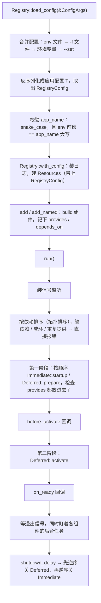

# app：Registry、组件、Resources

hygiea 应用框架的核心：程序按"组件"组织，Registry 负责读配置、按依赖排序启动组件、
等退出信号、按顺序关闭。具体组件（db、redis、http、grpc ……）怎么实现不在这里，
这里只讲它们都要遵守的那套机制。

代码在 `hygiea-core/src/app/`，`#[component]` 宏在 `hygiea-macros/src/component.rs`。

---

## 1. 几个概念

| 概念 | 是什么 | 谁建、谁用 |
|---|---|---|
| `Registry` | 组件注册表，整个应用的启动入口 | `main` 里 `load_config` 建出来，`add` 组件，`run().await` |
| `RegistryConfig` | 框架自己的配置：`app_name`、日志、关闭超时 | 放在应用配置的 `[registry]` 下；`Resources` 持有一份给组件读 |
| `Component` | 一个可启动、可关闭的单元（连接池、HTTP 服务……） | 组件作者实现；Registry 调用 |
| `Immediate` / `Deferred` | 组件的两种启动方式 | `Component::Kind`，`#[component]` 宏自动填 |
| `Resources` | 组件之间共享资源的容器，按"类型 + 名字"存取；另外带着 `RegistryConfig` | Registry 持有一份；组件往里放、从里取 |
| `ResourceSink` / `ReadyResources` | `Resources` 的阶段视图：只能放 / 只能读 | Deferred 组件的两个阶段拿到的参数 |
| `ResourceId` | "类型 + 名字"，声明 `provides` / `depends_on` 用 | 组件作者声明；Registry 排序、校验 |
| `ConfigResource` | "一份配置建一个资源"的资源 trait | 连接池类资源实现 |
| `ImmediateResourceComponent<R>` | 给 `ConfigResource` 套上的通用 Immediate 组件 | 连接池类组件直接用它，不用手写组件 |

---

## 2. 整体流程



任何一步失败（第一阶段、回调、第二阶段），已经启动的组件都会按关闭顺序关掉，`run` 返回错误。
运行中某个组件的后台任务自己结束了（panic 或提前退出），也当作失败：关掉所有组件，返回 `TaskExited`，
进程非 0 退出，交给 k8s / systemd 重启。

---

## 3. 配置和 app_name

- `Registry::load_config::<T>(&ConfigArgs)`：读配置、校验、建 Registry，返回 `(registry, config)`。
  应用配置 `T` 实现 `IntoRegistryConfig`，交出 `[registry]` 那一段。
- 配置来源和优先级、环境变量写法见 `hygiea-core/src/app/mod.rs` 的模块文档。
- 配置读不到、解析失败、校验不过都是启动期错误：这时日志还没装，把读了哪些来源（不含值）和错误打到 stderr，然后 panic。

`app_name` 是整个进程的身份：

- 格式是 `[a-z][a-z0-9_]*`：组件会拿它当 SQL 标识符（比如 live config 的表名前缀）。
- 环境变量前缀必须是它的大写：`app_name = "dict_jp"` 对应 `ConfigArgs::env_prefix("DICT_JP")`，对不上就报错。
- 默认是 `hygiea`，和默认的环境变量前缀 `HYGIEA` 对得上，什么都不配也能启动。
- 组件里不允许另外配置覆盖它（比如 PG 的 `application_name` 只能来自它）。

---

## 4. 组件

### 公共部分：`Component`

```rust
pub trait Component: Sized + Send + 'static {
    type Config;
    type Kind: sealed::Kind<Self>;            // Immediate 或 Deferred
    fn build(name: Name, config: Self::Config) -> Self;
    fn provides(&self) -> Vec<ResourceId>;    // 默认空
    fn depends_on(&self) -> Vec<ResourceId>;  // 默认空
    async fn stop(&mut self) -> Result<()>;   // 默认什么都不做
    fn shutdown_timeout(&self) -> Option<Duration>;  // 默认用 RegistryConfig 的
}
```

- `build` 不做 IO、不会失败，只是存下名字和配置；可能失败的事都放到启动方法里。
- `provides` / `depends_on` 在 `add` 时就取出来存好，之后不再变。
- 同一个组件类型可以用不同名字 `add_named` 多次（主库、从库），类型 + 名字重复会 panic。

### 两种启动方式

| | Immediate | Deferred |
|---|---|---|
| 典型 | 数据库、Redis、HTTP 客户端 | HTTP / gRPC 服务、MQ 消费者、定时任务 |
| 第一阶段 | `startup(&mut self, &Resources, shutdown)`：完成启动，可读可写 | `prepare(&mut self, &ResourceSink)`：只做准备（绑端口、校验），只能写 |
| 第二阶段 | 没有 | `activate(&mut self, ReadyResources, shutdown)`：开始工作，只能读 |
| 后台任务 | `startup` 返回 `Option<JoinHandle>` | `activate` 返回 `Option<JoinHandle>` |

分两阶段的目的是：**所有组件都准备好了，才有组件开始对外服务**。
比如端口被占用这种错误在 `prepare` 里就会暴露，这时还没有任何服务在接请求。

阶段视图让"在第一阶段读资源"编译不过（`ResourceSink` 没有 `get`），不用靠约定。
宏的 UI 测试 `hygiea-macros/tests/component_ui/fail/prepare_reads_resources.rs` 守着这一条。

### `#[component]` 宏

组件作者只写一个 impl 块：

```rust
#[component]
impl ImmediateComponent for MyComponent {
    type Config = MyConfig;
    fn build(name: Name, config: MyConfig) -> Self { .. }
    fn provides(&self) -> Vec<ResourceId> { .. }
    async fn startup(&mut self, state: &Resources, shutdown: CancellationToken) -> Result<Option<JoinHandle<()>>> { .. }
}
```

宏把 `Config`、`build`、`provides`、`depends_on`、`stop`、`shutdown_timeout` 拆到 `impl Component` 里，
按 impl 的 trait 填好 `Kind`，两个 impl 都加上 `#[async_trait]`。
用在别的 trait 上、手写 `type Kind`、方法名写错，都会编译报错。

### 内部：类型擦除

Registry 要把不同类型的组件放进同一个 `Vec`。`Kind::wrap` 把组件包成 `Box<dyn ComponentObject>`，
它只有三个方法：`startup`（第一阶段）、`activate`（第二阶段）、`stop`。

- Immediate 的包装：`startup` 调 `ImmediateComponent::startup`，`activate` 什么都不做。
- Deferred 的包装：`startup` 调 `prepare(&ResourceSink::new(state))`，`activate` 调 `activate(ReadyResources::new(state), ..)`。

`Kind` 在私有模块 `sealed` 里，外部只能用 `Immediate` / `Deferred` 两种。

---

## 5. Resources 和依赖

### Resources

```rust
#[derive(Clone)]
pub struct Resources {
    registry_config: Arc<RegistryConfig>,
    map: Arc<DashMap<ResourceKey, Arc<dyn Any + Send + Sync>>>,
}
```

- 按"类型 + 名字"存取：`insert` / `get` / `require`（匿名，名字是 `""`）和 `insert_named` / `get_named` / `require_named`。
- 任何 `Send + Sync + Clone + 'static` 都是 `Resource`。取出来的是克隆，所以资源本身应该是便宜克隆的句柄（内部 `Arc`）。
- 同一类型 + 名字重复 `insert` 会 panic：基本都是两个组件用了同一个名字。
- `require*` 取不到返回 `AppErr::ResourceMissing`，带上类型和名字。
- `Resources` 本身克隆很便宜（内部 `Arc`），`ResourceSink` / `ReadyResources` 都只是包了一份。

### provides / depends_on

组件声明自己提供哪些、依赖哪些 `ResourceId`，Registry 在 `run` 一开始就排好第一阶段的启动顺序：

- Kahn 拓扑排序：依赖都已排好的组件里挑 `add` 最早的，所以没有依赖关系的组件保持 `add` 的顺序。
- Deferred 组件的依赖只在第二阶段读（那时第一阶段都完成了），所以只检查有没有组件提供，不参与排序。
- 下面这些都在启动任何组件**之前**报错：
  - 依赖的资源没有组件提供：`ResourceMissing`
  - 同一个资源两个组件都提供：`DuplicateProvider`
  - 依赖成环：`DependencyCycle`，报出环上的组件，比如 `A(a) -> B(b) -> A(a)`
- 第一阶段每个组件启动完，检查它声明的 `provides` 真的放进去了，没放算启动失败。
- `before_activate` 里放进去的东西不属于任何组件，不能写进 `depends_on`，Deferred 组件在 `activate` 里直接取。

### 两个回调

| 回调 | 时机 | 拿到 | 适合做 |
|---|---|---|---|
| `before_activate` | 第一阶段全部完成后、`activate` 之前 | `Resources`（可读可写） | 建表、预热、把资源装配成应用的全局状态放回去 |
| `on_ready` | 所有组件 `activate` 完，已在接请求 | `Resources` | 注册到注册中心、打"已就绪"的点、自检 |

各只能设置一次，返回 `Err` 和组件启动失败一样处理。

典型用法（应用把需要的资源收进自己的状态，HTTP 的 router 函数在 `activate` 时取出来）：

```rust
registry
    .add::<SqlxPgComponent>(cfg.db)
    .before_activate(|res| async move {
        res.insert(AppState::build(&res)?);
        Ok(())
    })
    .add::<AxumComponent>(http_config)   // router 函数里 res.require::<Arc<AppState>>()
    .run()
    .await
```

---

## 6. RegistryConfig 和 ConfigResource

### 组件怎么拿到 RegistryConfig

`[registry]` 那段配置（应用名等）是进程级、启动前就确定的信息，不是组件产出的资源，所以不放进 map，
而是作为 `Resources` 的字段，建 `Resources` 时就给：

```rust
resources.registry_config().app_name      // Immediate::startup、两个回调
sink.registry_config().app_name           // Deferred::prepare：读不了资源，但能拿到它
ready.registry_config().app_name          // Deferred::activate
```

各阶段都能取，不用声明依赖：它从一开始就在。

### ConfigResource / ImmediateResourceComponent

Redis 连接池、HTTP 客户端这类组件做的事都一样：按配置建出资源、按组件名放进 Resources、关闭时关掉。差别只在怎么建、怎么关，
所以资源实现 `ConfigResource`，组件直接用通用的 `ImmediateResourceComponent<R>`：

```rust
#[async_trait]
impl ConfigResource for FredRedisPool {
    type Config = RedisConfig;
    async fn from_config(config: &RedisConfig, registry_config: &RegistryConfig) -> Result<Self> { .. }
    async fn close(&self) -> Result<()> { .. }
}
pub type RedisComponent = ImmediateResourceComponent<FredRedisPool>;
```

`ImmediateResourceComponent<R>`：

- `provides` 是 `ResourceId::named::<R>(组件名)`。
- `startup`：`R::from_config(&config, resources.registry_config())` → `insert_named(组件名, 资源)`。
- `stop`：调 `R::close`。
- 它没有 `depends_on`，所以 `from_config` 里只用配置和 `RegistryConfig`，不读别的资源（参数里也没有 `Resources`）。

`from_config` 要第二个参数，是因为它不经过 Registry 也要能调（测试、脚本），这时没有 `Resources`；
而有的资源在建的时候就要用应用名（PG 连接的 `application_name`、live config 的表前缀）。

不经过 Registry：`FredRedisPool::from_config(&config, &RegistryConfig::default())`，应用名是默认的 `hygiea`，和经过 Registry 不配时一样。

一个配置建多个资源、要跑后台任务、Deferred 组件，照常手写组件。数据库组件就是一个配置按 `uses` 建多个资源（业务池、
`DbLiveConfig`、`DbLock`）：6 种连接池共用一个手写的泛型组件 `DbComponent<C>`，不经过 Registry 用 `DbResources::from_config`
一次建出全部，规则一样（参数是配置和 `RegistryConfig`）。

---

## 7. 关闭

收到 Ctrl+C / SIGTERM（Windows 上还有 Ctrl+Break、关窗口、关机）后：

1. 先照常服务 `shutdown_delay_secs`（默认 0），让负载均衡器把流量切走；
2. 关闭顺序：先按启动的逆序关 Deferred（HTTP / gRPC 先停止接活），再按启动的逆序关 Immediate（被依赖的数据库最后关）；
3. 每个组件：触发它自己的 `CancellationToken` → 等它的后台任务结束 → 调 `stop`；
4. 每个组件单独计时（`shutdown_timeout`，默认 15 秒），超时的 abort 任务、打 WARN，接着关下一个，一个卡住的组件不会占掉后面组件的时间；
5. 关闭中再收到一次信号，直接退出进程。

启动成功后会打一行 `Max shutdown time`（delay + 各组件超时之和），部署时 k8s 的
`terminationGracePeriodSeconds` 要比它大。

信号监听在 `run` 一开始就装好：组件启动期间收到的信号会留着，启动完成后马上走优雅关闭，不会被系统默认行为直接杀掉。

---

## 8. 错误

`AppErr`（`hygiea-core/src/app/error.rs`）按阶段分段：

| 码 | 内容 |
|---|---|
| `01`–`03` | Registry 包装组件的失败：`ComponentStartFailed`、`TaskExited`、`ComponentActivateFailed`，组件自己的错误挂在 source 上 |
| `11`–`15` | 启动前检查：`ConfigMissing`、`InvalidConfig`、`ResourceMissing`、`DependencyCycle`、`DuplicateProvider` |
| `21`–`23` | 占用外部资源：`BindFailed`、`ConnectFailed`、`InitFailed` |
| `31` | 关闭：`StopFailed` |
| `99` | `ComponentError`：现有变体都不合适时的通用错误 |

组件直接用这些变体，底层原因 `wrap_err` / `with_source` 挂上。
