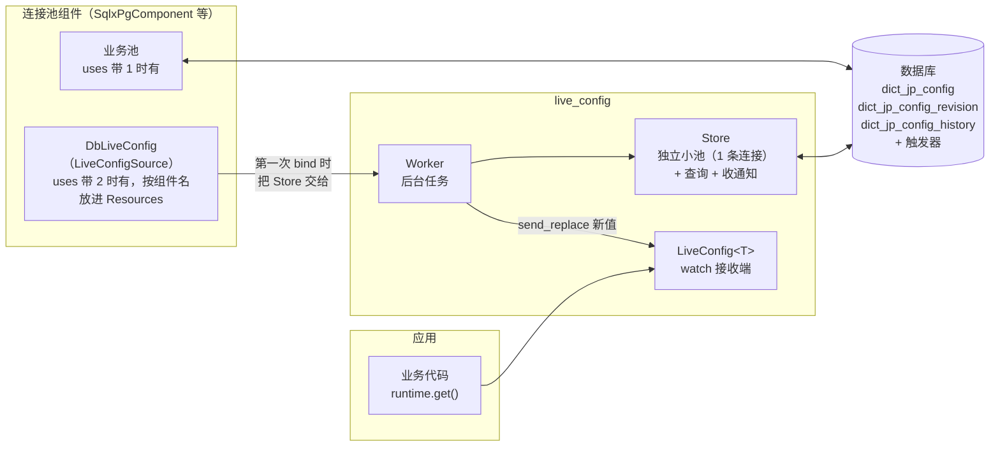
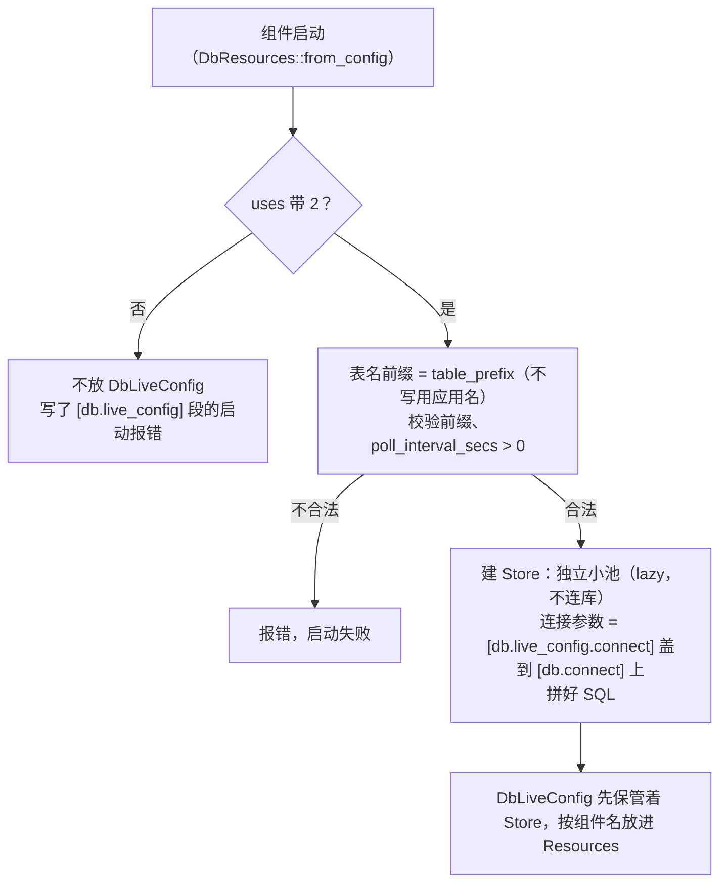
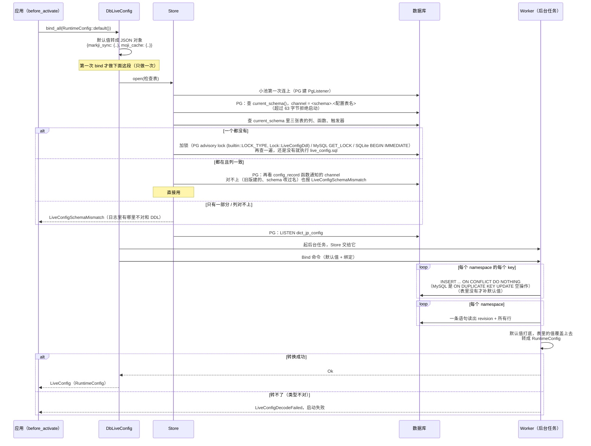
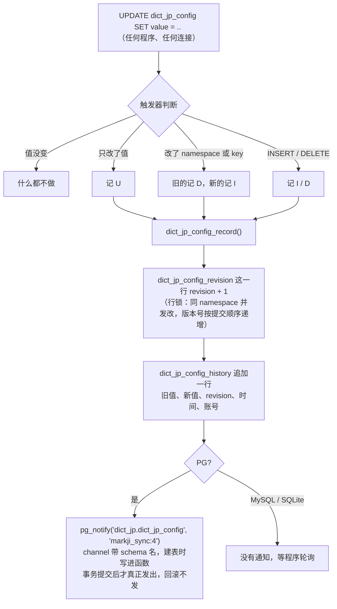
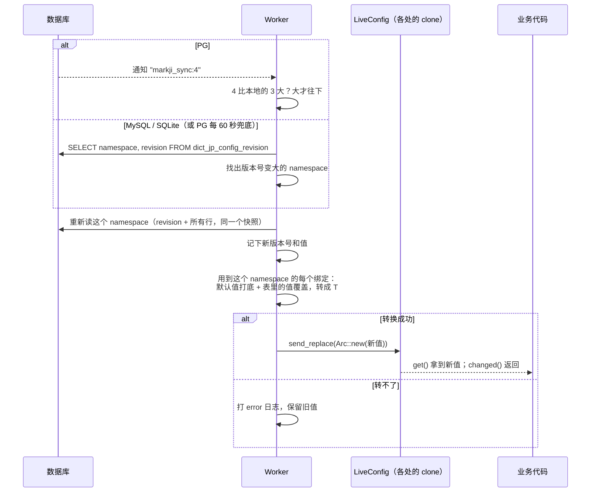
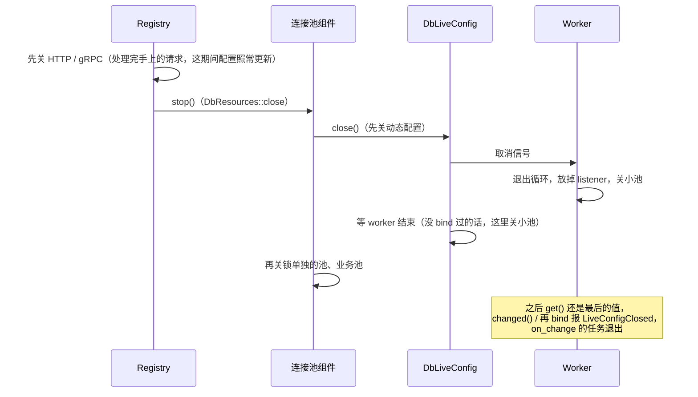

# live config（数据库配置表）：内部流程

怎么用、配置、读法、表结构、出了问题会怎样（对使用方而言）、用的时候要注意，都在模块文档里：
`hygiea-components/hygiea-db/src/live_config/mod.rs`（docs.rs 上是 `hygiea::db::live_config`），各类型、方法的细节在它们自己的文档。
这里只讲内部怎么做、为什么这样做。代码在 `hygiea-components/hygiea-db/src/live_config/`，
跑起来看效果：`cargo run -p hygiea-examples --example db_live_config`。

下面的例子里应用名是 `dict_jp`、没配 `table_prefix`，所以表名是 `dict_jp_config` 这一套，schema 是 `dict_jp`。

---

## 1. 由哪些东西组成

各部分在哪个文件见 `tools/docs.py tree hygiea-components/hygiea-db/src/live_config`：和驱动无关的（源、句柄、worker、表的规则）
在 `live_config/` 下，SQL 在 `src/sql/<数据库>/live_config.*`，执行在 `live_config/sqlx/`（一种数据库一个文件）。

---

## 2. 启动：组件建资源的时候

这一步不连库、不建表，只看配置。

---

## 3. 第一次 bind：连库、建表、起后台任务

后面再调 `bind` / `bind_all`，就不用再连库、建表了，直接发 Bind 命令给已经在跑的后台任务，同一个后台任务、同一条连接。

---

## 4. 运行中改了表：怎么传到程序

### 数据库那一侧（触发器）

### 程序这一侧（worker）

`bind_all` 的时候，一个 namespace 变了只重新读它自己，其他 namespace 用内存里的，整体重新转一个新的 `RuntimeConfig`。转换失败的话，整个 `RuntimeConfig` 保留旧值，不会出现一半新一半旧。

---

## 5. Worker 主循环

worker 是一个 tokio 任务，所有数据库操作都在它手里、在一条连接上串行执行。

几点说明：

- 业务读和 worker 写之间是 tokio `watch` 里的一把读写锁：`get()` 加读锁、clone 一下 `Arc`（引用计数 +1）就放开；
  worker 加写锁、把 `Arc` 换成新值就放开（转 struct 在加锁之前做完）。只有配置真的变了才写，读几乎不会等。
  拿到的 `Arc<T>` 是快照，之后换了新值也不影响手上这份；旧值等最后一个人用完才释放

- 等通知的那一步随时可以被取消：定时器到了、来了 Bind 命令，等通知的 future 会被丢掉，处理完再接着等。sqlx 收消息时读完整条才动缓冲区，丢掉也不会把连接弄坏
- 查询的时候来了通知，sqlx 先放进缓冲区，查完照样能取到，不会丢
- 只有读到的版本比本地大才换值：重复的通知、多实例、乱序都不会把新值换回旧的

---

## 6. 出了问题会怎样

| 情况 | 谁处理 | 结果 |
|---|---|---|
| 网络闪断（EOF、超时等） | sqlx 自动重连、重新 LISTEN | worker 收到"断过一次"，对一遍版本号补上漏掉的 |
| sqlx 返回别的错误（connection reset 等） | worker 丢掉 listener，在同一个小池上重建 | 重建后对一遍版本号 |
| 库挂了 | 重建失败，每 5 秒再试 | 这期间 `get()` 一直是旧值，不报错 |
| 连接被 NAT、防火墙悄悄断掉（不报错、也收不到通知） | PG 每 60 秒兜底轮询 | 轮询报错就重建，或者发现版本变大就补上 |
| 有人把值改成转不了的类型 | worker | 保留旧值，打 error；改回能转的值后恢复 |
| 有人删了 key | worker | 退回代码当前的默认值；下次 bind 补回表里 |

---

## 7. 关闭

---

## 8. 为什么这样做

- **字段方法每次读最新**：思路和 .NET 的 `IOptionsMonitor<T>.CurrentValue`、Netflix Archaius 的 `Property<T>.get()` 一样，
  持有的是句柄不是值。代价是连续调几个字段方法时中间可能换了版本，所以另外留了整块快照（`get()` / `snapshot()`）
- **版本号每个 namespace 一个、只接受更大的**：变了只重新读那一个 namespace；重复的通知、多实例、乱序都不会把新值换回旧的
- **变更历史程序不读**：版本号单独放在 `_config_revision`，历史只给人查，随便删不影响生效的值
- **表结构不迁移**：要么全对上直接用，要么一个都没有全建，有一个对不上就报错不启动，以后改结构手动执行 DDL
