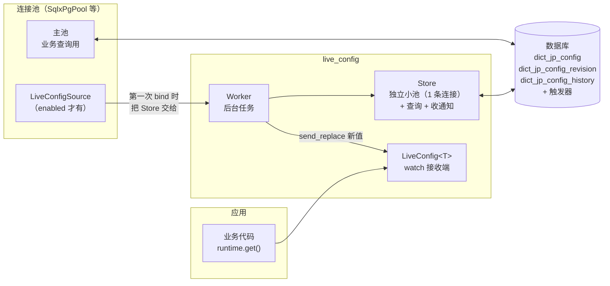
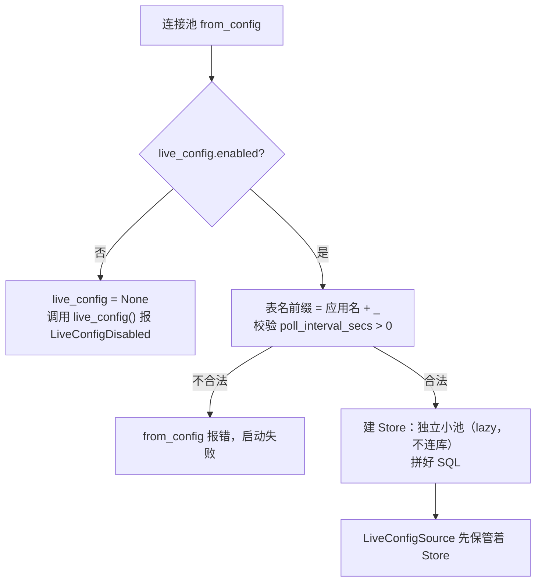
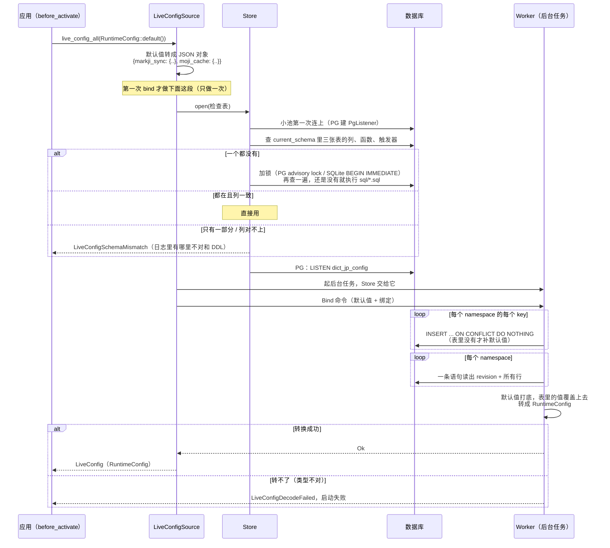
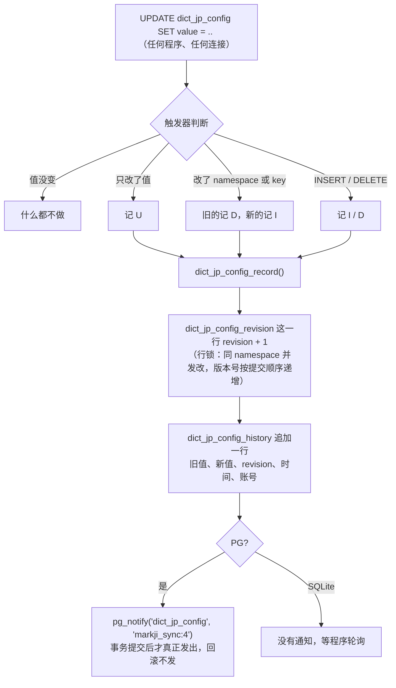
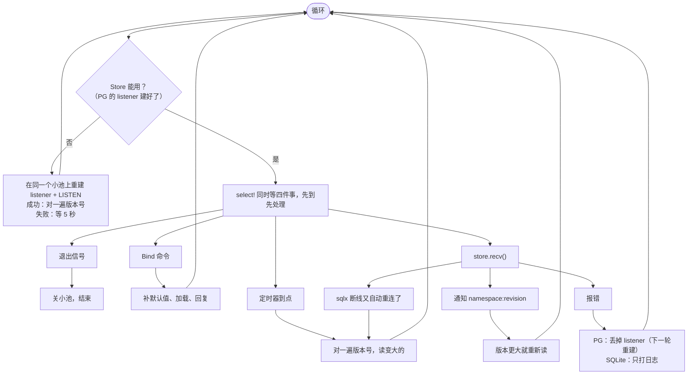
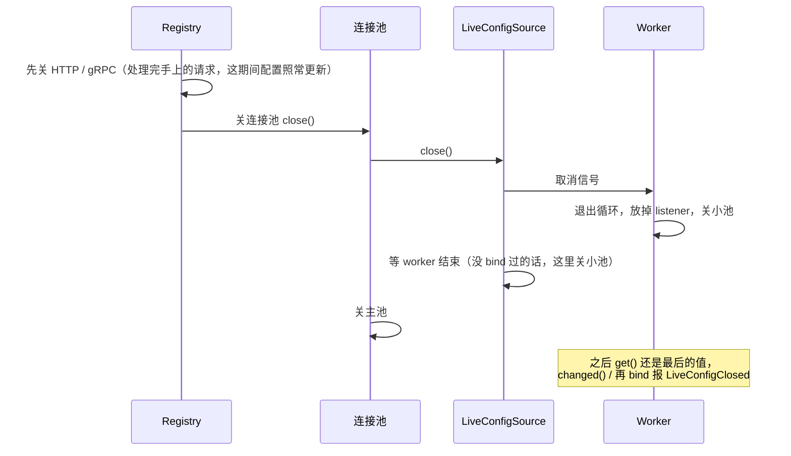

# live config（数据库配置表）：用法和内部流程

配置存在应用自己的库里，改了表，运行中的程序自动拿到新值，不用重启。它是连接池的一种能力：
开了 feature `live-config`，`SqlxPgPool`、`SqlxSqlitePool`、`SeaOrmPgPool` 上就多了两个方法。

代码在 `hygiea-components/hygiea-db/src/live_config/`，跑起来看效果：
`cargo run -p hygiea-examples --example db_live_config`。

下面的例子里应用名是 `dict_jp`，所以表名是 `dict_jp_config` 这一套。

---

## 1. 怎么用

### 配置

```toml
[db.connect]
host = ".."
schema_search_path = "dict_jp"   # 表建在 search_path 的第一个 schema 里

[registry]
app_name = "dict_jp"             # 应用名（小写下划线），也是表名前缀：dict_jp_config、dict_jp_config_revision、dict_jp_config_history

[db.live_config]
enabled = true                   # 默认不开，要用的连接池才写
# poll_interval_secs = 60        # 不写：PG 60 秒（兜底），SQLite 1 秒（主要靠它）
```

### 代码

```rust
/// 应用自己的配置：第一层字段是 namespace，第二层是 key
#[derive(Serialize, Deserialize, Default)]
pub struct RuntimeConfig {
    pub markji_sync: MarkjiSync,
    pub moji_cache: MojiCache,
}

#[derive(Serialize, Deserialize)]
pub struct MarkjiSync {
    pub auto_sync: bool,      // 业务字段：要不要自动同步（跟 [db.live_config] 的 enabled 开关无关）
    pub levels: Vec<i32>,
}
impl Default for MarkjiSync {
    fn default() -> Self { Self { auto_sync: false, levels: vec![1, 2] } }   // 表里没有时用这个
}

// before_activate（建 AppState）里绑一次
let db = resources.require::<SeaOrmPgPool>()?;
let runtime: LiveConfig<RuntimeConfig> = db.live_config_all(RuntimeConfig::default()).await?;
// 只要一个 namespace 也行：db.live_config("markji_sync", MarkjiSync::default())

// 业务里每次用都 get()，拿到的是当前最新的
let cfg = runtime.get();                 // Arc<RuntimeConfig>：当前快照，用的时候不持有锁
if cfg.markji_sync.auto_sync { .. }           // namespace markji_sync 的 key auto_sync

// service 只挂自己那一块：数据源还是上面那一个 runtime，取到的是它当前最新的
let markji = MarkjiService::new(runtime.view(|c| &c.markji_sync));   // LiveView<MarkjiSync>
// MarkjiService 里：if self.config.get().auto_sync { .. }

// 配置一变就要做点什么（比如定时任务重新排期）
let mut watcher = runtime.clone();
tokio::spawn(async move {
    while watcher.changed().await.is_ok() {
        let cfg = watcher.get();
        // ..
    }
});
```

### 改配置

直接改表就行，用 SQL 或者以后的管理页面：

```sql
UPDATE dict_jp_config SET value = '[1, 2, 3]' WHERE namespace = 'markji_sync' AND key = 'levels';
```

PG 几乎立刻生效，SQLite 最多等 1 秒。

### 表里长什么样

| namespace | key | value |
|---|---|---|
| markji_sync | auto_sync | `false` |
| markji_sync | levels | `[1, 2, 3]` |
| moji_cache | ttl_secs | `60` |

一行一个 key，值存 JSON。和代码的对应：

| 绑定方式 | namespace 从哪来 | 读 `markji_sync` 的 `auto_sync` |
|---|---|---|
| `live_config_all(RuntimeConfig::default())` | 总 struct 的第一层字段名 | `runtime.get().markji_sync.auto_sync` |
| `live_config("markji_sync", MarkjiSync::default())` | 参数传的字符串 | `sync.get().auto_sync` |

两种读的是表里同一行。

---

## 2. 由哪些东西组成



| 文件 | 负责 | 跟框架有关吗 |
|---|---|---|
| `mod.rs` | 对外：`LiveConfigOptions`、`LiveConfig<T>`、连接池上的两个方法（宏生成）；bind 入口；默认值 + 表里的值合并成 struct | 无关 |
| `worker.rs` | 后台任务：处理 bind、收通知、轮询、比版本号、重新加载、出错重建 | 无关 |
| `store.rs` | 独立小池和在上面做的事：建连接、加载、查版本号、补默认值、收通知 | sqlx |
| `schema.rs` | 表名、期望的列、DDL，第一次 bind 时检查和建表 | sqlx |
| `sql/*.sql` | PG、SQLite 的建表和触发器 | 各框架通用 |

---

## 3. 启动：连接池建好的时候

这一步不连库、不建表，只看配置。



---

## 4. 第一次 bind：连库、建表、起后台任务



后面再调 `live_config` / `live_config_all`，就不用再连库、建表了，直接发 Bind 命令给已经在跑的后台任务，同一个后台任务、同一条连接。

---

## 5. 运行中改了表：怎么传到程序

### 数据库那一侧（触发器）



### 程序这一侧（worker）


`bind_all` 的时候，一个 namespace 变了只重新读它自己，其他 namespace 用内存里的，整体重新转一个新的 `RuntimeConfig`。转换失败的话，整个 `RuntimeConfig` 保留旧值，不会出现一半新一半旧。

---

## 6. Worker 主循环

worker 是一个 tokio 任务，所有数据库操作都在它手里、在一条连接上串行执行。



几点说明：

- 业务读和 worker 写之间是 tokio `watch` 里的一把读写锁：`get()` 加读锁、clone 一下 `Arc`（引用计数 +1）就放开；
  worker 加写锁、把 `Arc` 换成新值就放开（转 struct 在加锁之前做完）。只有配置真的变了才写，读几乎不会等。
  拿到的 `Arc<T>` 是快照，之后换了新值也不影响手上这份；旧值等最后一个人用完才释放

- 等通知的那一步随时可以被取消：定时器到了、来了 Bind 命令，等通知的 future 会被丢掉，处理完再接着等。sqlx 收消息时读完整条才动缓冲区，丢掉也不会把连接弄坏
- 查询的时候来了通知，sqlx 先放进缓冲区，查完照样能取到，不会丢
- 只有读到的版本比本地大才换值：重复的通知、多实例、乱序都不会把新值换回旧的

---

## 7. 出了问题会怎样

| 情况 | 谁处理 | 结果 |
|---|---|---|
| 网络闪断（EOF、超时等） | sqlx 自动重连、重新 LISTEN | worker 收到"断过一次"，对一遍版本号补上漏掉的 |
| sqlx 返回别的错误（connection reset 等） | worker 丢掉 listener，在同一个小池上重建 | 重建后对一遍版本号 |
| 库挂了 | 重建失败，每 5 秒再试 | 这期间 `get()` 一直是旧值，不报错 |
| 连接被 NAT、防火墙悄悄断掉（不报错、也收不到通知） | PG 每 60 秒兜底轮询 | 轮询报错就重建，或者发现版本变大就补上 |
| 有人把值改成转不了的类型 | worker | 保留旧值，打 error；改回能转的值后恢复 |
| 有人删了 key | worker | 退回代码当前的默认值；下次 bind 补回表里 |

---

## 8. 关闭



---

## 9. 几个规则一句话总结

- **一个连接池最多一条连接给 live config**：PG 是 listener 占着，SQLite 是轮询用；不占主池的名额，第一次 bind 才连
- **表结构**：要么全对上直接用，要么一个都没有全建，有一个对不上就报错不启动；以后改结构手动执行 DDL
- **默认值**：表里没有的 key 才写进去，表里有的永远以表为准
- **版本号**：每个 namespace 一个，增删改都 +1，程序只接受更大的
- **namespace 粒度**：变了只重新读那一个 namespace
- 更多注意事项（字段改名、改类型、从库、`:memory:` 等）见 `live_config/mod.rs` 的「用的时候要注意」
